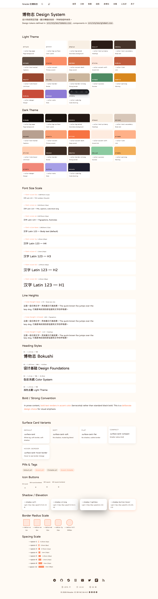
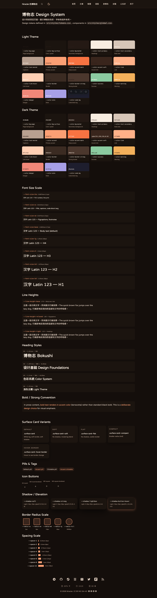

# 博物志 (Bokushi)

> "长门大明神会梦到外星羊么？"

Niracler 的个人博客，记录一个话唠的技术与生活。

## 这里有什么

- **长篇文章** — 游戏评测、ACG 作品分析、生活感悟
- **月记** — 流水账式的生活记录（本来想写周记，结果变成了半年记）
- **TIL** — Today I Learned，零散的技术笔记
- **动态频道** — Telegram 频道同步，日常碎碎念
- **漫画表情包库** — 从漫画里截的表情包收藏（Cloudflare D1 驱动）

## 设计预览

| Light | Dark |
|-------|------|
|  |  |

设计系统文章: [博物志的设计说明书](https://niracler.com/design) | 机器可读版: [DESIGN.md](DESIGN.md)

## 技术栈

[Astro](https://astro.build/) + [Tailwind CSS](https://tailwindcss.com/) + [Cloudflare Pages](https://pages.cloudflare.com/)

代码质量由 [Biome](https://biomejs.dev/) 管理，评论系统基于 Cloudflare D1 自建。

设计思路详见 [博物志的设计说明书](https://niracler.com/design)。

## 开发

```bash
pnpm install    # 安装依赖
pnpm dev        # 本地开发 (localhost:4321)
pnpm build      # 构建
pnpm preview    # 预览构建结果
```

## 项目结构

```text
src/
├── content/        # 内容（blog, monthly, til, galleries）
├── pages/          # 路由
├── layouts/        # 页面布局
├── components/     # 组件
└── styles/         # 样式（tokens + global）
```

## 链接

- **博客**: [niracler.com](https://niracler.com)
- **GitHub**: [@niracler](https://github.com/niracler)
- **Telegram**: [@tomoko_channel](https://t.me/tomoko_channel)

### 频道页边缘缓存

`/channel` 和数字游标分页（`/channel/before-123`、`/channel/after-123`）的匿名 GET
请求使用 Cloudflare Cache API 缓存完整 HTML 三天。命中后跳过 Telegram 抓取、
解析和 Astro 渲染；缓存过期后由下一次访问重新生成。缓存按域名、路径区分，存储于
当前 Cloudflare 数据中心，不保证跨地区共享；冷缓存仍会执行完整渲染。三天是缓存
有效期，不是定时刷新任务：到期后首次访问才重新抓取。新帖或内容编辑可能延迟
正常刷新时最多三天可见；Cloudflare 也可能提前淘汰缓存，导致更早重新抓取。

Telegram 多批次抓取和响应体读取共用八秒超时。成功页面在三天有效期后额外保留
七天作为故障备用：刷新超时、抛出异常或返回非个性化 5xx 时，可返回旧页面，
响应头标记 `X-Channel-Cache: STALE` 和 `Cache-Control: no-store`。失败不会延长
备用期限或覆盖成功页面；刷新恢复后替换旧内容。此时内容可能已过时，最长保留
十天。缓存被淘汰或不存在时仍会返回错误页，不保证始终有旧内容可用。

带 Cookie、Authorization 或查询参数的请求不使用共享缓存。错误页返回 502 和
`no-store`，不会覆盖正常页面；缓存服务故障时回退到实时渲染。浏览器每次重新验证，
避免将边缘缓存剩余时间额外延长。响应头 `X-Channel-Cache: MISS` / `HIT` 可用于
部署后验证，同一地区连续请求同一 URL 应从 MISS 变为 HIT。写入失败时为 BYPASS。

缓存命名空间为 `channel-pages-v2`（`src/middleware.ts`）；不需要新增 KV 绑定或凭据。
部署涉及频道 HTML 不兼容变更时可更新命名空间，否则故障期间可能返回保留的旧页面。

### 页脚统计

`scripts/site-stats-plugin.mjs` 在构建时读取 blog、monthly 和 til 的 Markdown/MDX，
沿用既有字数与阅读时长算法，向页面注入统计常量。Worker 不再为页脚遍历和解析
全站文章。线上统计随下一次构建更新；本地开发会在内容新增、修改或删除后刷新。
